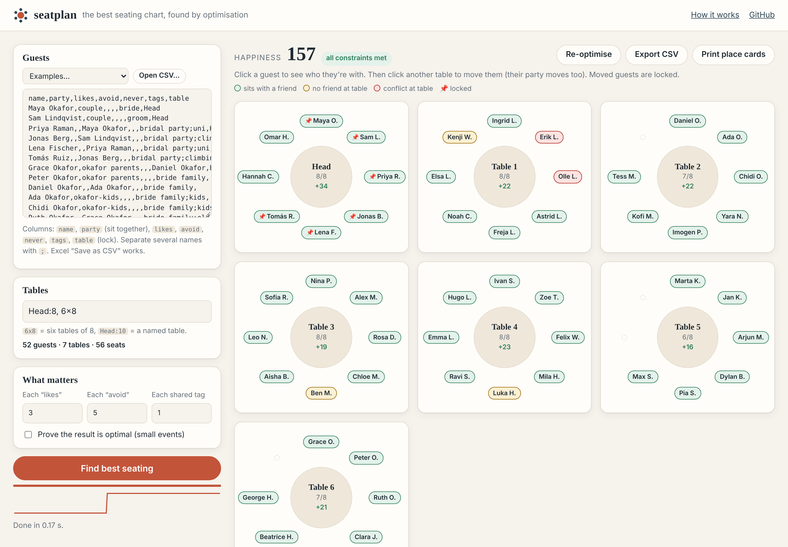
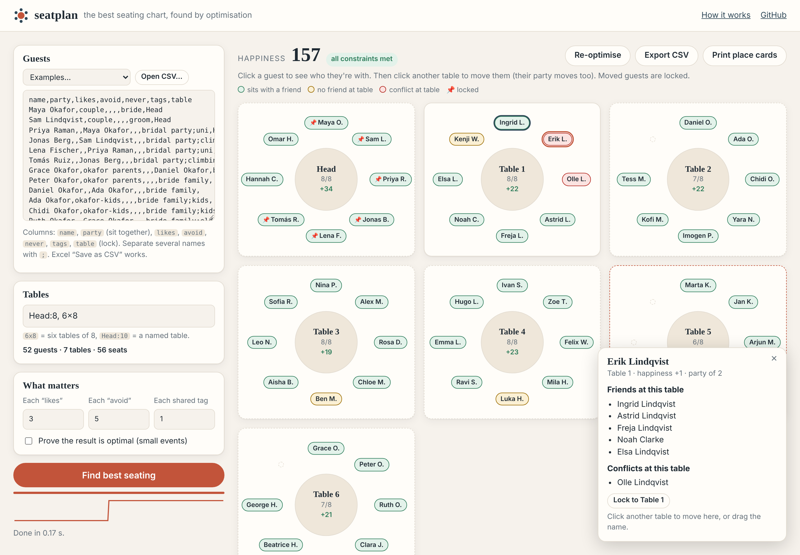

# seatplan

[](https://github.com/aadijewargi/seatplan/actions/workflows/ci.yml)
[](https://aadijewargi.github.io/seatplan/)
[](LICENSE)

**Give it a guest list, who must sit together, who must not, and your tables. It finds the best seating chart in well under a second.**

Weddings, dinners, classrooms, exam halls, team offsites: anywhere people sit at tables and some of them shouldn't sit together.

**[▶ Open the web app](https://aadijewargi.github.io/seatplan/)**. It runs entirely in your browser, so your guest list never leaves your computer.

<p align="center">
  
</p>

## Features

- **Hard constraints are always kept:** table capacities, parties (couples and families sit together), "never" pairs (feuding relatives apart) and guests locked to a table (the head table).
- **Soft preferences are maximised:** "likes", "avoid" and shared tags such as `college` or `work`. You choose how much each one is worth.
- **Fast and good.** On every benchmark instance small enough to check exactly, the result matches the proven optimum ([benchmarks](#benchmarks)). 400 guests take about 3 seconds.
- **Can prove optimality.** For small events, a branch-and-bound search confirms that no better seating exists.
- **Interactive.** Click or drag a guest to another table. Their party moves with them and stays locked. Press *Re-optimise* and the solver rearranges everyone else around your choices.
- **Explains itself.** Click a guest to see their friends and conflicts at the table; each table shows its happiness.
- **Practical output:** CSV export, printable place cards, and a command-line tool for scripts.
- **No server, no sign-up, no dependencies at runtime.** Works offline once loaded; also works on phones.

<p align="center">
  
</p>

## Using it

### Web app

1. Open **https://aadijewargi.github.io/seatplan/** (it loads a sample wedding and seats it straight away).
2. Paste or open your guest list as CSV (e.g. Excel → *Save As* → *CSV*).
3. Describe your tables, e.g. `Head:10, 8x8` (one head table of 10 plus eight tables of 8).
4. Press **Find best seating**. Then adjust by hand if you like and press **Re-optimise**.

### Guest list format

Only `name` is required. Column names are case-insensitive, columns can be in any order, and several names in one cell are separated by `;`.

| column | meaning | example |
|---|---|---|
| `name` | guest name (unique) | `Maya Okafor` |
| `party` | same value = must sit together | `okafor parents` |
| `likes` | would like to sit with | `Priya Raman;Lena Fischer` |
| `avoid` | would rather not sit with (soft) | `Olle Lindqvist` |
| `never` | must not share a table (hard) | `Daniel Okafor` |
| `tags` | circles they belong to; sharing a tag is a bonus | `uni;climbing` |
| `table` | lock this guest (and their party) to a table | `Head` |

```csv
name,party,likes,avoid,never,tags,table
Maya Okafor,couple,,,,bride,Head
Sam Lindqvist,couple,,,,groom,Head
Grace Okafor,okafor parents,,,Daniel Okafor,bride family,
Erik Lindqvist,lindqvist parents,,Olle Lindqvist,,groom family,
Hannah Cole,,Priya Raman;Lena Fischer,,,uni,
```

Full examples are in [`examples/`](examples). Semicolon-separated CSV (European Excel) and tab-separated files are detected automatically.

### Command line (Windows, macOS, Linux)

Needs [Node.js](https://nodejs.org) 22 or newer.

```powershell
git clone https://github.com/aadijewargi/seatplan.git
cd seatplan
npm install
node dist/cli.js examples/classroom.csv --tables "7x4" --out plan.csv
```

```text
Table 1  (4/4, happiness 13)
  + Ben
  + Finn
  + Nora
  + Pax
...
Total happiness: 99
```

For the wedding example, use `--tables "Head:8, 6x8"`. In the output, `+` = sits with a friend, `!` = sits with someone they avoid. Options: `--like 3 --avoid 5 --tag 1` (weights), `--prove` (try to prove optimality), `--seed N`, `--json`. The exit code is `2` if some hard constraint cannot be met (for example, more "never" pairs than tables allow).

### As a library

The solver in `src/core` is plain TypeScript with no dependencies:

```ts
import { solve, parseGuestCsv, parseTables } from "./src/core/index.ts";

const { guests, relations } = parseGuestCsv(csvText);
const { plan, optimal } = solve({ guests, relations, tables: parseTables("6x8") }, { prove: true });
plan.tables; // [{ name: "Table 1", capacity: 8, guests: [...] }, ...]
```

## How it works

### The problem

Each guest pair $\{i, j\}$ has a weight $w_{ij}$:

$$
w_{ij} = 3\cdot\#\text{likes} - 5\cdot\#\text{avoids} + 1\cdot\#\text{shared tags}
$$

(the weights are adjustable). A seating assigns each guest $i$ a table $t(i)$, and we maximise total happiness:

$$
\max_{t}\; \sum_{i<j,\; t(i)=t(j)} w_{ij}
\quad\text{s.t.}\quad
\left|\{i : t(i)=k\}\right| \le c_k \;\;\forall k,
\qquad \text{parties together, locks kept, "never" pairs apart.}
$$

This is a **graph partitioning problem with capacities**. It is NP-hard: it contains bin packing (just fitting the parties into the tables) and max-k-cut. Exhaustive search over $T^N$ seatings is hopeless beyond about a dozen guests (52 guests at 7 tables is about $10^{44}$ seatings). So seatplan uses a fast heuristic to find the answer and an exact method to check it.

### Step 1: contract parties

Every party becomes one atomic **unit** of size $s_u$, and weights between units are summed. Now "parties sit together" holds by construction, the search space shrinks, and weights inside a party become a constant. "Never" pairs become a penalty $H$ larger than every soft weight combined, so breaking one is always worse than any amount of happiness, but a seating still exists when the constraints conflict, and the app reports exactly which constraint broke.

### Step 2: simulated annealing

Starting from a greedy seating, the solver repeatedly proposes a random change and accepts it with the Metropolis rule. A change that improves happiness by $\Delta$ is always accepted, and a worse one is accepted with probability $e^{\Delta/T}$, where the temperature $T$ cools geometrically. Three kinds of change keep the search connected:

| move | what it does | why it's needed |
|---|---|---|
| **move** | one unit to a table with room | basic step |
| **swap** | two units of the same size trade tables | works when every table is full |
| **exchange** | a unit goes to table *b*, and random units from *b* come back to make room | lets a **couple trade places with two singles**. Without it, full tables lock parties in place: on the benchmark's "exactly full" instances, annealing without this move found the optimum only 8 times in 20; with it, 20 out of 20. |

**Incremental evaluation is what makes this fast.** The solver caches $S_{u,k} = \sum_{v \in k} W_{uv}$, unit $u$'s total weight to the people at table $k$. The change in score for moving $u$ from table $a$ to table $b$ is then

$$
\Delta_{\text{move}} = S_{u,b} - S_{u,a},
\qquad
\Delta_{\text{swap}} = S_{u,b} - S_{u,a} + S_{v,a} - S_{v,b} - 2W_{uv},
$$

which costs $O(1)$ to evaluate and $O(U)$ to apply. A large wedding runs a million proposals in under a second.

**The temperature calibrates itself.** It starts where an average bad move is accepted half the time, and ends where even a small one is accepted 0.1% of the time. Several restarts (alternating "shake up the best seating so far" and "fresh random packing") are followed by a steepest-ascent polish, so the result is always a local optimum. Runs are deterministic for a given seed.

### Step 3: proving optimality (branch and bound)

For small problems, `--prove` / *Prove the result is optimal* runs an exact search seeded with the annealing result. It places units one by one, most constrained first, and prunes a branch when even an optimistic estimate can't beat the best seating found so far. It uses the smaller of two **upper bounds**:

1. current score + every positive weight on a pair not yet decided ($O(1)$, from precomputed suffix sums);
2. current score + for each unplaced unit, its best gain at any table with room plus half the sum of its top-$K$ positive weights, where $K$ is the number of seats it could still share. This bound is much tighter and cut search nodes 5–12× on the benchmark instances.

**Symmetry breaking** also matters: empty tables of the same size are interchangeable, so only one of them is tried. That removes the $T!$ relabelings. Both bounds are valid and the search is complete, so if it finishes, the seating is the true optimum. It's practical up to about 20–25 parties; beyond that the search gives up and says so.

### Trade-offs

- Annealing gives no guarantee on large instances. That is the price of speed. The exact check covers the small cases, and on 99 benchmark instances it could verify, annealing matched the optimum every time.
- Happiness is counted per **table**, not per seat. "Sits next to" isn't modelled yet (see roadmap).
- Exact bin-packing feasibility is NP-hard too. If best-fit-decreasing and 200 randomized attempts can't fit the parties into the tables, seatplan reports it rather than searching forever. In practice that only happens when seats are extremely tight.

## Benchmarks

`npm run bench` regenerates [`bench/results.md`](bench/results.md). The instances are random but realistic: about 20% couples, two "likes" per guest, some "avoids", a few "never" pairs and friend circles. Times are on one CPU core under Node 22.

**Annealing vs the proven optimum** (20 instances per row; "instances" = how many the exact solver finished):

| guests | tables × seats | instances | annealing = optimum | anneal ms | exact ms | B&B nodes |
|---:|---|---:|---:|---:|---:|---:|
| 12 | 3 × 4 | 20 | **20/20** | 20 | 0.3 | 504 |
| 16 | 4 × 4 | 20 | **20/20** | 26 | 3 | 10,428 |
| 18 | 3 × 6 | 20 | **20/20** | 30 | 3 | 11,199 |
| 20 | 4 × 5 | 20 | **20/20** | 37 | 121 | 383,693 |
| 24 | 4 × 6 | 19 | **19/19** | 43 | 2,326 | 6,711,231 |

The exact solver's cost grows exponentially, while annealing stays in the tens of milliseconds and matches it every time.

**Scaling** (happiness, higher is better; broken "never" pairs in brackets; mean of 5 instances):

| guests | tables | random seating | greedy | **seatplan** | time |
|---:|---:|---:|---:|---:|---:|
| 50 | 6 | 77 (7) | 159 (0) | **242 (0)** | 0.13 s |
| 100 | 11 | 85 (2) | 263 (0) | **412 (0)** | 0.33 s |
| 200 | 21 | 98 (5) | 492 (0) | **801 (0)** | 0.97 s |
| 400 | 41 | 144 (6) | 937 (0) | **1498 (0)** | 3.2 s |

seatplan scores 50–60% higher than a sensible greedy seating.

## Tests

```bash
npm test        # 27 tests, ~2 s
npm run typecheck
```

The tests check correctness against **independent references**, not just "it runs":

- **Brute force:** on 60 random small instances (parties, locks, "never" pairs and unequal tables all mixed in), branch and bound matches exhaustive $T^U$ enumeration exactly, and annealing reaches that optimum on every one.
- **Two scorers agree:** the fast unit-level objective is checked against a separate guest-level evaluator that knows nothing about the party contraction.
- **Incremental bookkeeping:** after hundreds of random moves and swaps, the cached deltas and table loads match a full recomputation.
- **Known answers:** two cliques go to separate tables; feuding uncles are separated even when that costs happiness; three people who must all be apart at two tables produce exactly one reported violation.
- **Edge cases:** a single table, exact fit, everyone locked, zero weights, early stopping, determinism by seed, warm starts never getting worse, and every input error (duplicate names, unknown guests, an oversized party, contradictory locks, too few seats).
- **CSV parsing:** quoting, CRLF, BOM, semicolon- and tab-separated files, header aliases, and warnings for unknown names.

CI runs everything on **Ubuntu and Windows** with Node 22 and 24, and also runs a CLI smoke test.

## Development

```bash
npm install
npm run dev     # http://localhost:8000, rebuilds on save
npm run build   # dist/site (web app) + dist/cli.js
```

The code has no runtime dependencies. TypeScript is bundled with esbuild, and tests use Node's built-in test runner (via `tsx`).

```
src/core/   model, annealing, exact solver, scoring, CSV  (framework-free, used by both front ends)
src/app/    web app + Web Worker
src/cli.ts  command-line tool
test/       node:test suites, brute-force reference
bench/      benchmark script and results
```

## Roadmap

- Seat-level adjacency ("next to" and "opposite" at round or long tables), not just same-table
- Balance goals: even table sizes, mixing the two families
- Shareable links (compressed state in the URL) and Excel `.xlsx` import
- Visual table-layout editor (long tables, room plan)
- Exact solver via column generation / ILP for 40+ parties

## License

[MIT](LICENSE) © aadijewargi
